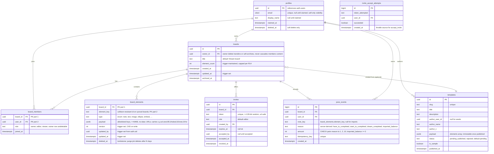

# Dreamspace Server Database - Plan

## Goal Capsule

- **Objective:** A person's board, people, team memberships, juice, and shared templates live server-side, so the 4 elements and 3 loops survive a browser session and work across devices and people. The first-visit experience keeps working with zero backend, even when the backend exists but is down or paused.
- **Means:** Postgres on Supabase (Auth, Row Level Security, Realtime) with an additive, flag-gated sync layer in the whiteboard app (KTD1, KTD5).
- **Authority hierarchy:** Locked specs from the owner interview (2026-10-12) > this plan's Product Contract > Planning Contract > unit-local choices.
- **Stop conditions:** The first-visit experience changes in any observable way; a signed-out or uninvited account can read someone else's board; a juice balance disagrees with its ledger; a backend outage delays or alters the Magic Moment.
- **Execution profile:** Plan-approved implementation only. ce-work starts after owner approval of this plan.
- **Tail ownership:** Prompt history, leaderboard, live cursors, and server-side API-key custody are designed-for but deferred; each lands as its own later plan.

---

## Product Contract

### Summary

Move the ai-whiteboard's memory from device-local `localStorage` to a hosted Postgres with row-level sharing, an append-only juice ledger, team memberships with invites, and a database-backed template gallery. The sync layer is additive and opt-in: with the runtime flag off (the default), the app is byte-identical to today's demo, including the Magic Moment.

### Problem Frame

Today every board dies with the device. `ideas/ai-whiteboard/index.html` stores the whole scene in `localStorage` key `aiwb.scene`, juice in `aiwb.juice`, and provider keys in `aiwb.provider.*`. Community templates travel as gzipped JSON inside GitHub issue URLs. Nothing the product promises - Join my Dream Team, Board Room, juice compared across people, a dream plan that outlives the session - can work while memory is per-device. The 4 elements and 3 loops each have something they must remember to be worthwhile; this plan derives the schema from exactly that. Two properties of the current client shape the hard parts of the sync design: `save()` persists the whole element array with no change tracking, and both undo and `adoptBoard` replace the array wholesale (`adoptBoard` also resets the element id counter), so naive sync would mint id collisions and let stale snapshots overwrite other people's rows.

### Key Decisions

- **Identity is email + name.** (session-settled: user-directed - chosen over passwords and over anonymous-only identity: lowest-friction durable identity for a consumer app.) Governs R1, R3.
- **First visit never needs a backend.** (session-settled: user-directed - chosen over server-first onboarding: people are being shown the app tonight and the Magic Moment must always land.) Governs R2, R6, R15.
- **Data moves server-side deliberately.** (session-settled: user-directed - chosen over keeping boards device-local: the elements and loops require shared, durable memory.) Governs R4, R7.
- **Realtime is the goal; MVP sync without live cursors is acceptable.** (session-settled: user-directed - chosen over blocking the first cut on presence/cursors.) Governs R5.
- **Core model: boards + notes, people, memberships, juice ledger, templates.** (session-settled: user-approved - owner confirmed this shape on 2026-10-12.) Governs R4, R8, R10, R12.
- **Prompt history is a future extension, not MVP.** (session-settled: user-directed - owner deferred the AI interaction history to a later cut.) Governs Scope Boundaries.

### Requirements

**Identity and access**

- R1. A person is remembered as email + display name, claimed by magic-link email. No passwords.
- R2. A first-time visitor gets the full Magic Moment and board with no account and no backend interaction.
- R3. Claiming an identity preserves everything the unclaimed person already had: board, note loop state, and juice balance.
- R17. Co-members see display names only. A person's email is visible to that person alone. Display names are unverified, so member lists show a disambiguator (avatar initial plus short id) alongside the name.

**Boards and sync**

- R4. Every board element (sticky notes, text, images, shapes, the three circles, embeds) persists server-side, scoped to its board.
- R5. A change made on one device appears on the person's other devices within a few seconds. Live cursors are not required in this cut.
- R6. With the sync flag off (the default), the app makes zero backend network calls and behaves exactly as it does today. A backend outage, including a paused free-tier project, never delays or alters the no-backend experience: backend calls fail open to local mode within 2-3 seconds.
- R7. On first sync, the device's existing scene and juice balance import without loss or duplication, and a raced import from two devices cannot create duplicate boards.
- R15. Signing in on a second device never silently discards local content. When both a local scene and a cloud board exist, the person chooses: open the cloud board (local scene stashed as a restorable backup) or keep the local scene as a second board.

**Dream Team**

- R8. A board owner can invite a person by link; accepting lands the person on the shared board as a member.
- R9. Board contents are readable by members and writable by owner and editors only, enforced in the database, not the client. Viewers read and cannot write. Ownership cannot be transferred away, demoted, or self-granted by non-owners.

**Loops and juice**

- R10. Every juice-earning completion is remembered as an event with its loop - have-to earns 1, want-to earns 2, dream earns 10 - so balances survive sessions and a later leaderboard can rank people per board. The server derives the loop and amount from the note's actual position and completion state; a note earns at most once, ever.
- R11. Note loop state (picked up by the team, done) persists with the note across sessions.

**Board Room**

- R12. A published template is remembered with title, author, and payload, and is readable by anyone, including signed-out visitors. A new community share is invisible until approved, per-person submission volume is capped, and a published template's payload cannot change afterwards.
- R13. The existing 13 static community templates carry over as published seed rows.

**Integrity and abuse bounds**

- R14. The server accepts only bounded, allowlisted element payloads: per-element size cap, element-type enum, no `data:` URLs, and a per-board element count cap.
- R18. Anonymous sign-in is lazy (first sync-worthy action, not page load), CAPTCHA-protected, and bounded by per-user quotas, so bots cannot fill `auth.users` or storage.

### Actors

- A1. Visitor: unclaimed, possibly sync-flag-off. Must never hit a wall.
- A2. Member: claimed or anonymous-authenticated person using sync.
- A3. Board owner: a member with ownership of a board; creates invites, changes roles.
- A4. Template author: anyone who shares a board as a template.
- A5. Moderator: the project owner (Lilly), approves template submissions. No admin UI in this cut; moderation is a SQL/dashboard action.
- A6. The team: background AI that writes answer and plan notes onto the board. Writes through the member's own session in this cut.

### Acceptance Examples

- AE1. Given a fresh browser and the flag default, when a person opens the app, then the Magic Moment plays and devtools shows no backend network calls. Covers R2, R6.
- AE2. Given a person with a claimed identity and content on device 1, when they open device 2 (which has its own local scene) and sign in by magic link, then they are offered the choice in R15: open the cloud board with the local scene stashed, or keep the local scene as a second board. Nothing vanishes either way. Covers R3, R7, R15.
- AE3. Given an invite link, when a friend opens it and accepts, then they see the shared board; when an uninvited account opens the board URL, they see nothing. Covers R8, R9.
- AE4. Given a completed note, when completion fires twice (retry, double event, or a moved note), then exactly one juice event exists for that note, with the amount the server derived from its circle. Covers R10.
- AE5. Given a community template submission, before moderator approval the gallery does not show it; after approval it does, signed out included; after approval its payload no longer changes. Covers R12.
- AE6. Given the Supabase project is paused or unreachable, when a person opens the app, then the Magic Moment and board work exactly as in AE1 within 2-3 seconds. Covers R6.
- AE7. Given a viewer on a shared board, when they attempt any element write, the database rejects it. Given any member, when they send a stale element version, the write is rejected and they re-pull. Covers R9, sync integrity.

### Scope Boundaries

Deferred for later (designed for, not built):

- Prompt history: the person's AI interaction history on the board (route, request, response, model, timestamp). Owner-directed future extension; schema sketch in Appendix C.
- Leaderboard: per-board juice rankings. The ledger makes this a query; build after invites exist.
- Live cursors and presence: Realtime channels carry them later; MVP syncs board contents only.
- Server-side custody of AI provider keys: keys stay in `localStorage` in this cut; a server vault is future work.
- Data-driven tool route table (W11): routes stay in code.
- Multi-board UI (`ideas/my-boards`): the schema supports N boards per person; the client keeps one active board per person in this cut.
- Point-in-time recovery and managed backup upgrades: backup posture is documented in the runbook (Appendix A note in U1); PITR is a paid-tier upgrade decision.

Outside this product's identity:

- Public anonymous editing of any board. Sharing is explicit, per board, by invite.
- A general social network around templates. Board Room is a gallery, not a feed.

### Success Criteria

- A fresh browser on the default flag reproduces tonight's demo exactly, Magic Moment included, with the backend up, down, or paused.
- A sticky created on one device is visible on a second device with the same identity within about 5 seconds.
- Every displayed juice balance equals the sum of that person-board's ledger events, across reloads and devices.
- A stranger account cannot read another person's board; a viewer cannot write; a stale write is rejected. Each is proven by a policy test, not by inspection.

---

## Planning Contract

### Key Technical Decisions

- KTD1. **Supabase over Render.** Supabase ships the four things this plan needs as managed features: Postgres, Auth (magic link and anonymous sign-in), Row Level Security, and Realtime (postgres changes now, broadcast/presence for cursors later). Render is a PaaS: it hosts Postgres and custom services, but auth, row-level sharing, and realtime would all be custom code plus a second service to run and on-call. For a solo owner shipping a demo-driven app, the managed backend removes the most build and the most ops. Free tier covers demo scale: 50,000 MAU, 500 MB database (pricing page, Appendix B). Two honest constraints: free projects auto-pause after about 1 week of inactivity (R6's fail-open requirement exists because of this), and the exit ramp is narrower than "plain Postgres" - the schema is portable, but RLS policies call `auth.uid()`, RPCs reference Supabase's auth schema, and the client uses supabase-js, so leaving Supabase means rewriting the auth and realtime glue, not just moving tables. Sources in Appendix B.
- KTD2. **Element-per-row storage with server-side concurrency control, over scene-as-blob.** Each board element is a row keyed `(board_id, element_key)` with a `jsonb` payload holding the client's element shape. A whole-scene blob would make every sync a full-board write, create last-writer-wins collisions across devices, and block note-level joins for loop state and juice. Per-row storage gives granular sync, per-note lifecycle, and cheap templates. Concurrency rule: every write is compare-and-set on the row's `version` (stale base versions are rejected and the writer re-pulls); a tombstone always beats an upsert for the same key; `version`, `updated_by`, and `updated_at` are set by database triggers, never accepted from the client. Plain client-clock last-writer-wins was rejected: offline replay would overwrite newer edits and resurrect deleted notes.
- KTD3. **Append-only juice ledger with server-derived earns.** `juice_events` rows are never updated or deleted; a balance is a SUM over the ledger. The client does not state the circle or amount: `earn_juice` reads the note's payload and the circle ellipses from `board_elements`, derives the loop from the note's actual position, requires the note's `l1Done` completion state, and writes the ledger event and the earned flag in one transaction. A unique index gives one earn per note ever, so retries, moved notes, and flipped flags cannot double-earn. Residual honesty: a determined member can still craft a completed note in the dream circle and earn 10 once per note; the cap makes farming linear and visible, and boards are friends-only. Revisit if the leaderboard goes public.
- KTD4. **Anonymous-first sessions, claimed later, lazily.** The first sync-worthy action (not page load) creates a Supabase anonymous user; the board attaches to that user id. Claiming email + name upgrades the same user id, so R3 holds by construction. Sign-in on a new device converts that device's session to the claimed user; the R15 choice handles any local content. Anonymous sign-in sits behind CAPTCHA and per-user quotas (R18). (session-settled: user-directed - instantiates the identity decision, chosen over email-first gating: the demo constraint forbids an account wall.) Governs R1, R2, R3, R15.
- KTD5. **Committed config, runtime flag gate, fail-open.** The Supabase URL and publishable anon key are committed in a config file - they are public by design; RLS, not secrecy, is the protection. Sync gates on a runtime flag that defaults off (`enabled: false`), with `?sync=on` opt-in and `?sync=off` as an always-available kill. Rollout is flipping the default; rollback is the URL parameter. The supabase-js library lazy-loads only for opted-in sessions, after the Magic Moment. A 2-3 second timeout with a circuit breaker fails open to local mode, so a paused or dead backend can never delay the first-visit experience (AE6). (session-settled: user-directed - instantiates the zero-backend first-visit decision, chosen over gitignored config: a config that never deploys would make the live site permanently serverless, defeating the product.) Governs R2, R6, R15.
- KTD6. **Row Level Security and database triggers are the only enforcement layer.** Every table gets RLS; board access goes through role-split membership policies (viewers read-only); Realtime runs private channels authorized by policies on `realtime.messages`. Ownership is pinned: the owner membership row cannot be deleted or demoted, role changes are owner-only, and no self-promotion path exists. Integrity fields (`version`, `updated_by`, `updated_at`) are trigger-set. Element deletes are tombstones only (hard deletes break RLS-visible realtime and sync merges); a scheduled job purges old tombstones. `profiles.email` is exposed to self only; co-members read a display-name-only view. Membership checks use security-definer helper functions with pinned `search_path` to avoid recursive policies.
- KTD7. **Outbox-based dual-write, localStorage canonical first, explicit promotion gate.** The client writes localStorage as today and mirrors to the server through an outbox with bounded retries and a dead-letter state the UI surfaces quietly. Only when the gate in the migration table passes does the server become the read source for signed-in boards. Rollback at every step is `?sync=off`.

### High-Level Technical Design

Schema sketch (directional; final DDL is written at implementation time):



Supporting objects and rules:

- `juice_balances` view: `board_id, user_id, sum(amount)`. Leaderboard later is the same view ordered.
- `board_member_profiles` view: `id, display_name` only, for co-member display (R17).
- One-earn index: unique partial index on `juice_events (board_id, note_key)` for the three completion reasons.
- RPC `import_board(scene jsonb, import_key text)`: creates the board, its owner membership row, and element rows in one transaction; dedupes on `import_key`; remaps client `e<n>` ids to collision-resistant keys. Element ids on synced boards are nanoid-style, and the client never resets its counter from imported content (today `adoptBoard` resets `nextId = 1`; on synced boards this is what would mint colliding keys).
- RPC `earn_juice(board_id, note_key, idempotency_key)`: validates membership, reads the note and circle ellipses from `board_elements`, derives the loop from the note's position, requires `l1Done`, writes ledger event + earned flag atomically. The `imported_balance` backfill fires only at board creation.
- RPC `accept_invite(token)`: security-definer; single indexed lookup; validates token state, throttles repeated attempts per user via `invite_accept_attempts`, adds membership, marks accepted. Token entropy (>=128-bit) makes guessing impractical; the throttle covers brute force.
- RPC `upsert_elements(board_id, elements[])`: validates each payload against the per-type key allowlist and size cap (R14), applies CAS on `version`, tombstone-wins; triggers set `version`, `updated_by`, `updated_at`.
- Trigger: on `auth.users` insert, provision `profiles` row. Triggers set all integrity fields and maintain `boards.element_count`.
- Quotas (R18): per-user board count cap and per-board element cap enforced by trigger; anonymous sign-in behind CAPTCHA (Supabase project setting, hCaptcha or Turnstile).
- Realtime: `board_elements` and `juice_events` in the supabase_realtime publication; private channel per board, authorized by membership policy on `realtime.messages` (RLS is already enabled there; add policies only, never `ALTER TABLE realtime.messages`).
- Purge: scheduled job (pg_cron) hard-deletes tombstoned `board_elements` older than a set retention.

Sync sequence:

```mermaid
sequenceDiagram
    participant B as Browser
    participant L as localStorage
    participant S as Supabase
    B->>B: flag on (?sync=on or default)? no: today's app, zero backend calls
    B->>B: Magic Moment plays first; supabase-js lazy-loads after
    B->>S: first sync-worthy action: signInAnonymously (CAPTCHA), 2-3s timeout
    S--xB: timeout or error: circuit breaker, fail open to local mode
    B->>L: read aiwb.scene, aiwb.juice
    alt first sync (no board id stored)
        B->>S: import_board(scene, import_key) + imported_balance event
        S-->>B: board_id (deduped on import_key)
        B->>L: store board_id
    else returning
        B->>S: pull rows where updated_at > cursor - overlap window
        B->>B: merge per element by version; tombstones win
    end
    loop on save()
        B->>B: diff els against last-synced snapshot (per element_key)
        B->>S: outbox -> upsert_elements(changed only, base versions)
        S--xB: stale version: re-pull, server wins, quiet UI note
        S--xB: repeated failure: dead-letter, quiet UI badge
    end
    S-->>B: postgres changes on board channel -> merge -> draw
```

Client sync integrity (the hard part, unit U9):

- The client keeps a last-synced snapshot of the scene. `save()` diffs the current array against it by `element_key`; only changed, added, or removed keys enter the outbox.
- Undo no longer replaces the array on synced boards: the undo stack records per-action element deltas, and applying undo upserts the prior states of exactly those elements. A remote merge is never undone.
- Wholesale loads (template, `adoptBoard`) route through merge-by-id as upserts of the incoming elements, not array replacement, on synced boards.
- Offline writes queue in the outbox with their base versions; replay is CAS, so a stale replay is rejected and re-pulled rather than overwriting newer state.
- Server-sourced rows are untrusted input: every inbound row passes through the client's existing `loadEls(rows, false)` sanitizer before touching the scene.

Device-local to server-side migration phases:

| Phase | What exists | Client behavior | Gate to next phase |
|---|---|---|---|
| M0 (tonight) | Nothing changes | localStorage only | - |
| M1 | Schema migrated on hosted Supabase | localStorage only; flag absent/off | Migrations apply clean twice |
| M2 | sync behind `?sync=on` | opt-in only, on test machines and the owner's | Demo-safety matrix passes on the deployed site |
| M3 | Import + dual-write | localStorage canonical, server mirror | 7 clean days on the owner's own daily boards: no lost elements, no duplicate imports, balances matching, zero unresolved dead-letters, second-device drill (AE2) passed |
| M4 | Server canonical for signed-in boards | localStorage becomes offline cache | Signed-out path still pure local; AE6 passes |
| M5 | Flag default flips on; claim, invites, Board Room, juice live | Full loop | `?sync=off` verified as kill switch |

### Assumptions

- Supabase free tier covers demo scale (50,000 MAU, 500 MB database, unlimited API requests per the pricing page). Flagged: free projects auto-pause after about 1 week of inactivity and automatic backups are not included on the free tier; R6's fail-open design covers the pause, and U1's runbook covers the backup posture.
- AI provider keys stay client-side (current BYOK architecture). Server custody is future work; this plan adds no new key handling.
- Magic-link email via Supabase's default sender is acceptable for the first cut; a custom sender is polish.
- One active board per person covers MVP use; the schema already supports many.
- Anonymous sessions can be lost if a person clears browser data before claiming (Supabase-documented behavior). localStorage still holds the scene, and the claim prompt should arrive early; accepted as MVP risk.
- The claim flow uses Supabase's documented anonymous-to-permanent conversion; verify exact current supabase-js behavior at implementation time, including the email-already-registered branch and secure email-change settings.

### Alternatives Considered

- **Render + custom backend.** Postgres plus a hand-rolled API, auth, and websocket layer. Rejected: the three hardest parts of this plan (auth, row-level sharing, realtime) become custom code and a second service to operate, for control the product does not need yet.
- **Scene-as-single-jsonb per board.** One row per board holding the whole `aiwb.scene` array. Rejected: full-board writes on every change, last-writer-wins across devices, and no note-level queries for loops, juice, or templates.
- **Local-first sync engine (Yjs, ElectricSQL, PowerSync).** Real CRDT collaboration and offline-first semantics. Rejected for this cut: another system to learn and operate, and CAS-per-element covers single-owner multi-device reality; the schema does not preclude adopting one later.
- **Gitignored config as the sync gate.** Rejected: with a static deploy, a config that is never committed means the live site is permanently serverless; the runtime flag gives the same default-off safety with a real rollout path (KTD5).
- **Keep the GitHub-issue template flow.** Templates as gzipped payloads in issue URLs. Rejected: no gallery queries, no moderation states, no author identity; Board Room's "every board's a cheat code" needs a browsable, approvable store.

### Risks & Dependencies

| Risk | Consequence | Mitigation |
|---|---|---|
| RLS policy recursion between boards and board_members | Policies fail or lock everyone out | Security-definer `is_board_member(board_id)` helper with pinned `search_path`; policy tests with two accounts |
| Browser data cleared before claim | Anonymous account and its server board orphaned | localStorage still canonical until M4; early claim prompt; documented limitation |
| A member crafts completed notes to farm juice | Inflated leaderboard numbers | Server derives circle and amount; one earn per note ever; friends-only boards; revisit before a public leaderboard |
| jsonb payload drifts as the client evolves | Old rows unreadable by new client | Client `loadEls` sanitizes on read; `version` column reserved for payload migrations; server allowlist bounds shape |
| Free-tier pause after ~1 week inactive; connection caps; anonymous users count toward MAU | Dead backend on demo day; sync stalls at scale; MAU surprise | R6 fail-open circuit breaker; lazy anon sign-in + quotas; Pro tier is a config change, not a redesign |
| No automatic backups on free tier | Data loss has no managed restore | U1 runbook: scheduled export (pg_dump) cadence, Pro upgrade path noted |
| Magic-link email lands in spam | Claim flow feels broken | Copy sets expectations; custom sender later |
| Bots hammer anonymous sign-in or invite accept | Filled auth.users, storage-fill DoS, token brute force | CAPTCHA on sign-in (R18), per-user quotas in triggers, accept throttling via `invite_accept_attempts` |

---

## Implementation Units

### U1. Supabase project and migration plumbing

**Goal:** A repeatable way to create and migrate the database, checked into the repo.
**Requirements:** foundation for all units; R6 groundwork.
**Dependencies:** none.
**Files:** `ideas/ai-whiteboard/supabase/config.toml`, `ideas/ai-whiteboard/supabase/migrations/`, `ideas/ai-whiteboard/supabase/README.md`, `ideas/ai-whiteboard/supabase-config.js` (new, committed), `.gitignore` (new at repo root - the repo has none)
**Approach:** Supabase CLI layout inside the whiteboard directory. The committed `supabase-config.js` carries the publishable URL and anon key plus `enabled: false` (KTD5); `.gitignore` covers only true secrets (service-role key, local env files), never the publishable config. README is a short runbook: link a hosted project, push migrations, reset a local database, enable CAPTCHA on sign-in (project setting), and the backup posture - no automatic backups on the free tier, so a scheduled export cadence plus the Pro upgrade path.
**Patterns to follow:** SQL migrations, one file per change, timestamp-prefixed.
**Test scenarios:**
- `supabase db reset` on a fresh local stack applies every migration cleanly, twice in a row.
- `supabase-config.js` loads with `enabled: false` and contains no service-role key.
**Verification:** a fresh local Supabase shows the full schema after reset; publishable config committed, secrets ignored.

### U2. Core schema migration

**Goal:** The tables, constraints, indexes, triggers, and views in the HTD exist.
**Requirements:** R4, R8, R9 (structure), R10, R11 (loop state lives in the element payload), R12, R13 (structure), R14
**Dependencies:** U1
**Files:** `ideas/ai-whiteboard/supabase/migrations/202610121430_core_schema.sql`
**Approach:** One migration creating profiles, boards, board_elements, board_members, invites, invite_accept_attempts, juice_events, templates; the reason/amount CHECK; payload size and type-enum CHECKs; uniques on `invites.token`, `juice_events.idempotency_key`, and the one-earn partial index; `updated_at`/`updated_by`/`version` integrity triggers; `boards.element_count` maintenance trigger with cap; profile-provisioning trigger on `auth.users`; `juice_balances` and `board_member_profiles` views. No hard cascades: profiles soft-delete; owner deletion transfers or soft-archives boards, never cascades members' content.
**Test scenarios:**
- Insert with mismatched reason and amount (dream_completed, 1) is rejected by the CHECK.
- Duplicate `idempotency_key` insert is rejected; a second completion event for the same note is rejected by the one-earn index.
- Payload over 64KB, a `data:` image URL, and an unknown element type are each rejected.
- The element-count cap rejects the element past the limit.
- Client-supplied `version`/`updated_by`/`updated_at` values are overridden by triggers.
- New `auth.users` row produces a `profiles` row.
**Verification:** schema matches the HTD sketch; constraint tests pass.

### U3. Authorization: RLS, RPCs, realtime channels

**Goal:** Database-enforced access control per R9 and R17, plus the RPCs and private per-board realtime.
**Requirements:** R8, R9, R10, R17, R18, R5
**Dependencies:** U2
**Files:** `ideas/ai-whiteboard/supabase/migrations/202610121530_rls_rpcs_realtime.sql`
**Approach:**
1. Enable RLS on all app tables; membership checks via security-definer `is_board_member(board_id)` and `is_board_role(board_id, role)` helpers with pinned `search_path`.
2. Policies, role-split: boards and board_elements readable by members; element writes owner and editor only (viewers rejected); board_members readable by co-members through the display-name-only view, role changes owner-only, the owner row undeletable and undemotable, no self-promotion; invites creatable by owner, not directly readable by token holders; juice_events insertable only via `earn_juice`, readable by board members; templates published-readable by everyone including the anon role, pending visible to author only, author updates blocked once published, per-author pending cap enforced, status changes by the project owner via dashboard; profiles email self-only (R17).
3. RPCs `import_board`, `earn_juice`, `accept_invite`, `upsert_elements` per HTD, each security-definer with pinned `search_path` and full input validation; `accept_invite` throttled via `invite_accept_attempts`.
4. Realtime: add tables to the publication; private channels with membership policies on `realtime.messages`.
**Test scenarios:**
- Two test accounts: member reads board rows, stranger's select returns nothing; co-members read display names but not emails.
- Viewer read succeeds; viewer element write is rejected (Covers AE7).
- `earn_juice` as non-member fails; without `l1Done` on the note fails; replayed with the same key returns the original event; the amount matches the note's actual circle, not a client claim.
- `accept_invite` succeeds once; second use, revoked token, and expired token fail; repeated failed attempts are throttled.
- Role change by a non-owner fails; owner-row delete and demote fail.
- `import_board` with one malformed element rolls back the whole import.
- Non-member cannot join the board's realtime channel.
**Verification:** policy test suite passes against a local stack.

### U9. Client sync integrity layer

**Goal:** The diff, undo, conflict, and outbox machinery that makes sync safe against the client's wholesale-replace habits. This is the hardest unit in the plan.
**Requirements:** R5, R6, R7, sync integrity (AE7)
**Dependencies:** U3
**Files:** `ideas/ai-whiteboard/sync-engine.js` (new), `ideas/ai-whiteboard/sync-engine.test.js` (new)
**Approach:**
1. Last-synced snapshot: `save()` diffs the scene against it by `element_key`; only deltas enter the outbox.
2. Element-scoped undo: the undo stack records per-action element deltas on synced boards and applies them as compensating upserts; remote merges are never undone.
3. Wholesale loads (template, `adoptBoard`) merge by id as upserts on synced boards instead of replacing the array.
4. Collision-resistant element ids on synced boards, with a one-time remap on import; the id counter never resets from imported content.
5. Outbox: bounded retries with backoff, then dead-letter with a quiet UI badge; replay carries base versions so stale writes are rejected and re-pulled.
6. Pull: `updated_at` cursor minus an overlap window; per-element idempotent merge by version; tombstones win.
7. Every inbound row passes through `loadEls(rows, false)` untrusted sanitization before touching the scene.
**Execution note:** Build this test-first against a fake transport; the diff/undo/conflict matrix is where the subtle bugs live.
**Test scenarios:**
- Edit three notes: exactly three upserts, not a full-scene write.
- Undo after a remote merge: only the locally changed elements revert; remote additions survive.
- Template load on a synced board: incoming elements upsert; existing remote elements untouched.
- Two clients mint elements concurrently: no key collision; both survive.
- Stale replay (offline queue with old base version): rejected, re-pulled, server state wins (Covers AE7).
- Delete on device 1, edit same note on device 2: tombstone wins on both.
- Server down: writes dead-letter after bounded retries; local board keeps working.
- Malicious inbound row (script URL, junk keys, oversized): defused by `loadEls(rows, false)` before render.
**Verification:** the full matrix passes against a fake transport, then against a local stack.

### U4. Client sync module behind the runtime flag

**Goal:** R5, R6, R7: anonymous-first sync that is inert and invisible unless opted in.
**Requirements:** R2, R5, R6, R7, R18
**Dependencies:** U9
**Files:** `ideas/ai-whiteboard/sync.js` (new), `ideas/ai-whiteboard/index.html` (flag check, lazy loader), `ideas/ai-whiteboard/sync.test.js` (new)
**Approach:**
1. Flag resolution: `?sync=off` wins, then `?sync=on`, then the committed config's `enabled` (default false). Flag off: no supabase-js fetch, no backend calls, byte-identical behavior (R6 by construction).
2. Flag on: Magic Moment plays first; supabase-js lazy-loads after; anonymous sign-in happens on the first sync-worthy action, not page load (R18).
3. Circuit breaker: 2-3 second timeout on backend calls; on failure, fail open to local mode for the session (AE6).
4. First sync: import per the sequence diagram (scene fan-out, `imported_balance` event, id remap, store `board_id`).
5. Do not sync embeds of `kind: app`: their HTML lives in `aiwb.app.*` localStorage and does not travel (the client's own share snapshot already excludes them); app publishing to Pages stays the sharing path.
6. Before rollout past M2, verify how the demo is actually deployed and served, so the flag behavior on the live site is proven, not assumed.
**Execution note:** Prove the flag-off path first with a smoke pass (fresh profile, Magic Moment, no network), then the sync path. Characterization before modification where `index.html` is touched.
**Test scenarios:**
- Flag off: zero backend requests, Magic Moment plays (Covers AE1).
- Flag on, backend down or paused: same experience within 2-3 seconds (Covers AE6).
- First sync maps a populated `aiwb.scene` to element rows and stores `board_id`; raced import from two clients dedupes on the import key.
- Two open clients: a note created in one appears in the other; a delete propagates as a tombstone.
**Verification:** second device shows a sticky within about 5 seconds; flag-off demo unchanged.

### U5. Identity claim and second-device sign-in

**Goal:** R1, R3, R15, R17: magic-link claim that upgrades the anonymous session in place, with an explicit second-device flow.
**Requirements:** R1, R3, R15, R17
**Dependencies:** U4
**Files:** `ideas/ai-whiteboard/auth.js` (new), `ideas/ai-whiteboard/index.html` (claim modal, member list)
**Approach:** Minimal modal asking email + display name; magic link via Supabase Auth on the existing anonymous user; on confirm, the profile row gets email, display_name, claimed_at. User id never changes, so boards, memberships, and juice follow automatically. Second device: magic-link sign-in converts the session to the claimed user; when both a local scene and a cloud board exist, the person chooses per R15 - open the cloud board (local scene stashed under the client's existing `.prev.` backup-key pattern, restorable) or keep the local scene as a second board. Never silently discard. Spec the email-already-registered branch (Supabase's obfuscated response: treat as "check your email", never reveal which) and enable secure email change in project settings. Member lists show display name plus disambiguator (R17).
**Test scenarios:**
- Claim keeps the same user id; pre-claim board and juice remain attached.
- Claim form requires both fields; bad email rejected; already-registered email produces the neutral check-your-email path.
- Second-device sign-in with content on both sides: both choices offered; each preserves everything (Covers AE2).
- Member list shows display names and disambiguators, never emails.
**Verification:** claim on one device, sign in on a second, both boards handled per choice; no content loss in any branch.

### U6. Juice ledger integration

**Goal:** R10: `Juice.earn` calls the server-deriving RPC when synced; the meter reads the ledger.
**Requirements:** R10, R7 (balance import)
**Dependencies:** U4 (U5 not required; anonymous users earn too)
**Files:** `ideas/ai-whiteboard/juice.js`, `ideas/ai-whiteboard/sync.js`
**Approach:** On earn: keep the local animation, and when synced call `earn_juice(board_id, note_key, idempotency_key)`; the server derives the loop and amount from the note's position and `l1Done` state (KTD3). Meter balance is the local number when offline, the ledger sum when synced; first sync backfills `aiwb.juice` as one `imported_balance` event at board creation only. Leaderboard stays out (deferred).
**Test scenarios:**
- One completion, two earn calls (retry): one event, balance moves once (Covers AE4).
- A note moved between circles after completion cannot re-earn; the recorded amount matches the circle it was completed in.
- Balance on a second device equals the ledger sum.
- Offline earns replay once on reconnect via the outbox.
- Import backfills the pre-sync balance exactly once; a second device's local balance is not double-counted (it is subsumed at board creation; documented).
**Verification:** balance survives reload and matches across devices.

### U7. Dream Team: invites and membership

**Goal:** R8, R9: invite links, accept flow, member list.
**Requirements:** R8, R9, R17
**Dependencies:** U4 (U5 for claimed names on the member list; anonymous members show as guest)
**Files:** `ideas/ai-whiteboard/team.js` (new), `ideas/ai-whiteboard/index.html` (invite dialog, member list)
**Approach:** Owner creates a single-use invite link (`?invite=<token>`). Opening it runs `accept_invite` (throttled); success lands the person on the shared board with the board channel subscribed. Viewers get read-only boards (policy-enforced, AE7). Member list reads `board_members` through the display-name view.
**Test scenarios:**
- Owner creates a link; friend accepts and sees the board (Covers AE3).
- Uninvited account opening the board URL sees nothing.
- Used, revoked, or expired token is rejected with a friendly message; repeated bad tokens are throttled.
- New member receives existing elements and live changes.
- A viewer sees the board but every write is rejected.
**Verification:** two accounts on one shared board edit simultaneously without seeing other boards.

### U8. Board Room: database-backed templates

**Goal:** R12, R13: gallery reads published templates from the database; shares land pending and capped.
**Requirements:** R12, R13
**Dependencies:** U3 (U5 optional for author attribution)
**Files:** `ideas/ai-whiteboard/supabase/seed/templates_seed.sql` (ports the 13 static JSON files), `ideas/ai-whiteboard/templates.js` (new), `ideas/ai-whiteboard/index.html` (gallery + share flow when synced)
**Approach:** Seed migration ports `ideas/templates/*.json` into `templates` as published, preserving author names and `is_sample`. Gallery reads DB when synced, falls back to static files otherwise. Share-as-template inserts a pending row instead of opening a GitHub issue URL when synced; the issue flow stays as the flag-off fallback. Per-author pending cap applies; published payloads are immutable (fixes land as new submissions). Approval is a moderator dashboard action.
**Test scenarios:**
- Gallery shows published rows to a signed-out visitor; pending rows hidden (Covers AE5).
- Submission lands pending with author attribution; the per-author cap rejects the one past the limit.
- Author cannot update a published row.
- Seed rows match the 13 static files in title and payload.
- A template payload crafted with script URLs, oversized fields, and junk keys is defused by the client's existing `loadEls` sanitization on load.
**Verification:** a template travels from share to approved to gallery with no code deploy.

### U10. CI: migration, policy, and demo-safety gates

**Goal:** The tests in this plan run on every PR, so the demo-safety and authorization promises cannot regress silently.
**Requirements:** R6, R9 (regression-proofing), all policy tests
**Dependencies:** U3, U4 (the paths it exercises)
**Files:** `.github/workflows/whiteboard-db.yml` (new)
**Approach:** One workflow: spin up a local Supabase (`supabase start`), apply migrations, run the policy test suite and the `node ideas/ai-whiteboard/*.test.js` files, and run a demo-safety smoke (headless browser or jsdom: flag off, fresh profile, Magic Moment plays, zero backend requests - AE1; backend unreachable, same within 2-3 seconds - AE6).
**Test scenarios:**
- Workflow fails when a migration breaks, a policy test fails, or the smoke detects a backend call on the flag-off path.
- Workflow passes on the merged result of U1-U8.
**Verification:** a deliberately broken migration on a throwaway PR fails CI.

---

## Verification Contract

| Gate | How | Proves |
|---|---|---|
| Migrations | `supabase db reset` twice on a clean local stack | U1, U2 apply repeatably |
| Policy tests | SQL/pgTAP-style policy tests from U3 against a local stack | R9, R10, R17, R18 enforcement, RPC semantics |
| Client tests | `node ideas/ai-whiteboard/<name>.test.js` (repo's existing pattern) | U4-U9 unit behavior, incl. the U9 conflict matrix |
| CI | U10 workflow on every PR | none of the above can regress silently |
| Demo-safety matrix | Fresh browser profile, flag default: Magic Moment plays, zero backend calls; backend paused/unreachable: same within 2-3 s; on the deployed site, not just locally | R2, R6 (tonight's constraint), AE1, AE6 |
| Cross-device | Two browsers, one identity: sticky appears within ~5 s; juice matches; second-device choice drill | R5, R10, R15 (AE2) |
| Stranger/viewer/stale tests | Uninvited read: empty; viewer write: rejected; stale version write: rejected | R9 end-to-end (AE3, AE7) |

## Definition of Done

- All ten units landed; every unit's test scenarios pass; CI is green on the merged result.
- The demo-safety matrix passes on the deployed site, not just locally, including the paused-backend case.
- No behavior change on the flag-off path: first-visit experience identical to tonight.
- A second device sees board changes within about 5 seconds, juice balances match the ledger, and the R15 choice drill loses nothing.
- Policy tests prove strangers cannot read, viewers cannot write, and stale writes are rejected.
- Abandoned-attempt code (spike sync drafts, unused config shapes) is removed, not left in the diff.

---

## Appendix

### A. Device-local inventory and target mapping

| localStorage key | Contents today | Server target | Cut notes |
|---|---|---|---|
| `aiwb.scene` | Full element array of the one board | `board_elements` rows | Imported on first sync (R7); ids remapped to collision-resistant keys |
| `aiwb.scene.prev.<ts>` | Backup stashed by template loads | same pattern reused | R15's second-device stash uses this existing pattern |
| `aiwb.view` | Camera x/y/zoom | stays local | Per-device preference, not shared state |
| `aiwb.juice` | Juice balance integer | `juice_events` `imported_balance` backfill | Backfill once, at board creation only |
| `aiwb.provider.*` | BYOK API keys, provider choice | stays local | Server custody is future work |
| `aiwb.app.*` | Generated mini-apps | stays local | Published apps already live on Pages; app embeds do not sync |
| `aiwb.shape`, `wb_want_last` | UI prefs | stays local | Device preferences |
| `aiwb.pendingTemplate` (sessionStorage) | Template awaiting load | `templates` read path | Gallery reads DB when synced |

### B. Sources

- Supabase vs Render comparison (2026), buildmvpfast.com: https://www.buildmvpfast.com/compare/supabase-vs-render
- Supabase pricing (free tier: 50,000 MAU, 500 MB database, pause after 1 week of inactivity, automatic backups not included; anonymous sign-ins included): https://supabase.com/pricing
- Supabase Realtime Authorization (private channels, `realtime.messages` RLS, the ALTER TABLE trap): https://supabase.com/docs/guides/realtime/authorization
- Supabase Row Level Security: https://supabase.com/docs/guides/database/postgres/row-level-security
- Supabase Anonymous Sign-Ins (anonymous user upgrade, `is_anonymous` claim, browser-data-clear caveat): https://supabase.com/docs/guides/auth/auth-anonymous
- Supabase CAPTCHA (hCaptcha / Turnstile on sign-in): https://supabase.com/docs/guides/auth/auth-captcha
- Origin product framing: `plans/dreamspace-next-phase.md` (locked vocabulary, 4 elements, 3 loops, juice economy, build order)

### C. Future extension sketches (not built in this plan)

- **Prompt history** (owner-directed future extension): `prompt_history(board_id, user_id, route, request_text, response_text, model, created_at)`, RLS readable by the owning member. Feeds The Invisible AI Toolbox's memory and a later "how my board thinks" view.
- **Leaderboard**: `juice_balances` ordered per board, opt-in display name, after invites exist. Revisit juice self-minting before a public leaderboard (Risks).
- **Presence and live cursors**: Realtime broadcast/presence on the existing per-board private channels; no schema change needed.
- **Tool route table (W11)**: `tool_routes(name, label, about, model_slot, enabled)` replacing the in-code ROUTES map; adding a tool becomes a row insert.
