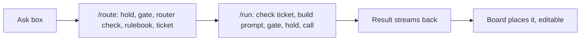

# AI Magic Toolbox: architecture

Status: draft v4, 2026-10-15. No code written.
Review history: v1 fresh-eyes (fix first, 10 findings), v1 feasibility (11 findings), v2 re-review (pass with fixes),
v3 re-review (pass with fixes, 3 partial gaps plus 9 new issues). v4 addresses all of them. Lilly answered questions 15 and 17
and half of 16 on 2026-10-17. v4 itself has not been re-reviewed.
Building waits on three things: Remember stuff verified, the live-board freeze lifted, and the database check (is Supabase the right one?).
PR #171 (board saving on Supabase) merged 2026-10-15 with sync switched off, so this doc's index.html line numbers need a recheck.
Decisions and research behind this doc: `plans/2026-10-14-invisible-ai-toolbox-brief.md`.
Diagrams and step counts: https://claude.ai/artifact/Nk153vwTLu693xr8RRWXoe (private).

## 1. What it is

One box on the board. You type anything. The board works out what kind of job it is, picks the right AI, runs it,
and puts the result on the board, where everything stays editable. People never pick a model, never see a key,
and never leave the board.

For: the 99% who barely touch AI, and people with a million ideas a minute.
First experience: someone types a dream, and an editable idea map lands on the board.

## 2. Decisions

Locked (Lilly):
1. The first ask lands as an idea map: a center note plus branches, every box and line editable.
2. The empty ask box shows typewriter hints that cycle through 3 dream-builder prompts. They stop on click and are never sent.
3. We build our own router: one gateway, with our rules for which AI runs when. OpenRouter is the supplier, not the brain.
4. MVP jobs are chat and code. Images and video come later.
5. Quality first, then speed. Each job gets an AI good enough that it never feels dumb, and then that AI runs as fast as possible.
   Speed never comes from swapping in a weaker AI.
6. The router weighs the kind of task, how hard it is, and draft vs polish.
7. We provision keys (the merchant model). There's no "do you have OpenRouter?" question.
8. The server holds every key we provision, and every AI call on those keys goes through it. Security is spelled out in section 6.
9. A light free plan with very low spend. Bonus credits when an invited friend actually collaborates on a board.
10. US only at launch. 18+ is in the terms. No age question.
11. A monthly plan. People keep unused credits. Refunds follow the common SaaS pattern (a lawyer confirms).
12. Zero data retention is on. The long-term direction is open models.
13. Credits are a separate system from juice points. No link between them.
14. Money is Tier 4. For every purchase, Stripe, our ledger, and OpenRouter have to agree.
15. The AI disclosure lives in onboarding (it's already there). Its wording gets checked against Anthropic's policy and EU AI Act Article 50.
16. Free credits get spent before paid credits (2026-10-17).
17. Failed attempts are charged at their real cost for now, not free (2026-10-17). The job is to make failures rare (4.8).
18. One way to use AI: every call goes through our server. No bring-your-own-key path (2026-10-17).

Proposed, not yet approved: no upfront open-vs-frontier choice for users, the free plan running on open models,
session memory (4.7), next moves (4.9), the "creative or precise" router clue, the invite-bonus rules, the refund default,
and unused free credit expiring monthly.

## 3. How one ask travels



1. The browser sends the ask, a board summary, and session memory to `/route`.
2. `/route` confirms who's asking and places a hold. It runs the safety gate on the ask, then the router check (one cheap AI call,
   with thinking turned off), then the rulebook. The gate and the router are both billed like any call. It stores a ticket on the
   server holding the person, a hash of the ask, the job, the clues, and the pick, and returns the ticket ID, which is signed and
   expires after a few minutes.
3. The browser's job handler sends `/run` the ticket ID plus the job's inputs: the ask, the board data, the board picture
   when the job uses one, and session memory.
4. `/run` refuses anything without a valid ticket, or with an ask that doesn't match the ticket's hash. It builds the final prompt
   from the server's own template for that job, runs the safety gate on the whole payload (text and picture), places a hold,
   calls OpenRouter with the stored pick, streams the answer back, and settles the hold to the exact cost.
5. If the answer fails (an error, a cut-off answer, or a reply that can't be read), that attempt still settles to its real cost,
   because OpenRouter charges for it. The handler then asks `/run` once more on the same ticket as attempt 2, and the server moves
   to the next model in the pick. A ticket allows two attempts at most.
6. The browser places the result on the board and logs how it went (redo, undo, edit, next-move tap).

Every AI call holds first and settles after, with no exceptions: the gate, the router, handlers, retries, and next-moves follow-ups.
The browser never chooses a model, writes a prompt template, or sees a key we provisioned.
Today the job prompts live in the browser (index.html), so they move to the server. Draw's prompt uses a font measurement
taken in the browser (index.html:840-843, used at 645), which gets sent along as an input.

### Every AI entry point

| Where in the board | Job | How it gets a ticket |
|---|---|---|
| The ask box, `send()` | draw, edit, or build | `/route` with the router check |
| "Make it real" (index.html:3759-3767) | build | `/route` with the job named, no router call, tied to the app's `el.prompt` |
| An app's Retry (index.html:3049) | build | same as "Make it real" |
| Dream plan (index.html:3885) | plan | `/route` with the job named, no router call, fixed rulebook row |
| Have-to loop (loop1.js:41, via index.html:3970) | todo | `/route` with the job named, no router call, fixed rulebook row |
| Next moves after an app build | nextmoves | the server issues it from the build's ticket, fixed rulebook row |

Every ask passes the safety gate, even when the job is named. Every key check in today's code (index.html:2236-2237,
3527-3528, 3764, 3880-3881, loop1.js:74) becomes a check for a signed-in session or tester pass. Merchant users go to
`/route` and `/run`, and never see the paste-a-key screen.

## 4. Components

### 4.1 Ask box
Today: index.html:268. New: typewriter hints. The third prompt's wording is still pending.

### 4.2 Router check
Today: one fast browser call returns the job (index.html:2156-2231). If the reply is junk, the ask falls back to draw.
New: it runs on the server inside `/route`, and the same single call returns more clues. It's held and billed like any call.

```json
{ "route": "draw|edit|build", "steps": ["..."], "confidence": 0.0, "ask": null,
  "difficulty": "easy|medium|hard", "stage": "draft|polish", "tone": "creative|precise" }
```

Whether a picture is attached isn't a router clue, since the router never sees the picture. `/run` reads it from the actual payload.
The safety gate is separate (4.3), so named jobs that skip the router still get gated.
The router keeps today's rule that text inside the request is never an instruction (index.html:2165).

### 4.3 Rulebook
New. A pure function on the server:
`pick(job, clues, payload, person) -> { models: [first, ...backups], effort, answerBudget, thinkingBudget, sort, temperature, maxPrice }`.
It's table-driven, and every model comes from an allowlist. If a picture is attached, it only picks models that can see images.
Answer length and thinking length are budgeted separately, because on many models thinking comes out of the same budget
as the answer. Today's build cap (9000 tokens, index.html:3555) could otherwise get eaten by thinking.
Fixed rows: the router (thinking off), the safety gate, plan, todo, and nextmoves.
The safety gate row is a cheap check model, held and billed like any call. Phase 0 picks it, including whether it can read
pictures. If it can't, pictures go to a separate check or get described in text first.
It gets tested without calling any AI. Model IDs get chosen after an idea-map quality test, preferring open models wherever they pass.

### 4.4 Plug
New. One OpenAI-compatible translator to OpenRouter, server side. Every call sets:
`models` (first choice plus backups), `provider.sort` ("throughput" or "latency"), `provider.data_collection: "deny"`,
`provider.zdr: true`, `provider.max_price`, `reasoning.max_tokens` (the thinking budget), `max_tokens` (answer budget plus
thinking budget), and `user` (a hashed person ID). Every call runs on the person's own OpenRouter key (or the tester's),
including the gate and the router check.
OpenRouter's `models` list only falls back when an error happens before the answer starts. Cut-off and unreadable answers
get handled by the attempt-2 step in section 3.
There's no bring-your-own-key path (decision 18). Today's paste-your-key setup, the Anthropic and OpenAI translators (index.html:440-560),
and the "key stays on this device" copy (index.html:326, 3997) go away when this ships. Line numbers are from before PR #171 merged; recheck them.

### 4.5 Server piece
New. The host follows the database decision. Supabase Edge Functions is today's candidate.
- `POST /route`: hold, gate, router check (unless the job is named), rulebook, ticket.
- `POST /run`: checks the ticket, gates, holds, streams the answer, and settles the cost.
- `POST /stripe-webhook`: handles the events in section 5.
- On email confirmation (not on account creation), it creates the person's OpenRouter key and grants the first free allowance,
  once per normalized email address.
- A retry queue re-sends any key-limit update that failed.
- A monthly job grants each free allowance and, if approved, expires the unused part of the last one.
- A cleanup job settles holds left behind by calls that got cut off.
- A daily job resumes paused billing once a balance drops low enough (section 5).
- A daily reconciliation job compares the money records. It only flags, and never fixes money.

Time limit: assume the Supabase cap (150s free, 400s paid) applies to streamed answers too. Phase 1 runs on a paid plan,
which also avoids free projects pausing after 7 days of low activity. The board's own build cap (today up to 300s, index.html:3532)
stays under 400s. Phase 0 tests a streamed answer running past 150s.

### 4.6 Accounts and credits
New. Sign-in comes from the database track. Table names are provisional.
- `credit_ledger`: append-only, in OpenRouter dollars. Reasons: grant (paid), grant (free), bonus, hold, settle, release, refund,
  refund failed, dispute, dispute restored, expire, adjustment. Unique keys: `stripe_event_id`, `invoice_id` (paid grants),
  `refund_id`, and our own request ID (settles).
- `ai_keys`: the person or tester pass, OpenRouter key hash, encrypted key, current limit, disabled and paused flags.
- `ai_usage`: written the moment a call starts, keyed by our own request ID. The generation ID gets filled in when the first
  chunk arrives, and the cost when the call ends. Holds the person, model, job, and latency. Never prompt text.
- `route_tickets`: ticket ID, person, ask hash, job, clues, pick, expiry, and attempts used.
- `collab_bonus`: inviter, invitee, board, and the time it qualified.

The browser can read its own balance and nothing else, and it can write nothing.

### 4.7 Memory (proposed)
Session memory: the last few asks and what each did, kept in the browser and sent with each ask.
Origin: everything the AI makes stores the ask that made it (apps already do this as `el.prompt`, index.html:3538).
Long-term memory across sessions comes later.

### 4.8 Your team and recovery (defaults, open for review)
While it works: today's status words (index.html:2110-2130), plus job-specific ones.
On failure: the failed attempt settles to its real cost, then attempt 2 runs on the next model. If that fails too,
the ask stays in the box and the board says what happened in plain words.
Locked: the person pays the real cost of a failed attempt for now (decision 17), so a failure plus its retry costs them both.
Zero failures can't be guaranteed (outages, broken output, timeouts), so the work is keeping them rare: track the failure rate
per AI per job, have the router stop picking an AI that fails too often, and set a failure-rate target in the passing criteria.

### 4.9 Next moves (proposed)
After each result, the board offers 2-3 specific next steps tied to it. Each tap is a normal ask.
Draw and edit replies carry them in a `nextMoves` field. App builds reply with bare HTML (index.html:596),
so builds get one cheap follow-up call (the nextmoves row), held and billed. The phase 0 cost measurement includes this.

## 5. Money

- Units: the ledger and the OpenRouter key limit are both in OpenRouter dollars. The markup M gets applied once, at purchase:
  paying $P grants $P / M of usage. M covers OpenRouter's 5.5% top-up fee, Stripe's fees, server costs, and margin.
  People see a friendly credits number, never dollars of usage.
- The limit rule: after every money event, including a duplicate one, SET the key's limit (never add to it) to
  max(total granted minus total deducted, current usage). Granted includes paid and free grants, bonuses, and adjustments.
  Deducted means refunds, disputes, and expirations. If the OpenRouter update fails, the retry queue re-sends it.
  The daily check uses the same formula, but only flags.
  Example: $10 granted, $8 used, $10 refunded leaves a limit of $8 (no more spending). A $10 renewal then makes it $10, so $2 is spendable.
  UNVERIFIED: that OpenRouter's key-update call accepts a new `limit` (the doc page 404'd). Phase 0 confirms it.
- Spend order (proposed): free credits get spent first, then paid credits. An expiration only removes unspent free credit,
  and free credit still on hold at expiry counts as spent.
- Plans: a free plan (a monthly allowance in the ledger, never through OpenRouter's `limit_reset`; whether unused free credit
  expires is question 16) and a paid monthly plan (credits that never expire).
  Prices come after measuring what one idea map costs, next moves included.
- Holds: before every call, the server holds the worst-case cost: an estimate of the input (prompt plus picture) plus
  `answerBudget + thinkingBudget` at `max_price`. Holds count against the balance, so calls running at once can't overspend.
  Up to 6 app builds can run at once today (index.html:698). After the call, the hold settles to the exact `usage.cost`.
  If the cost never arrives (Stop, a closed tab, or a timeout), the cleanup job settles it by generation ID through
  OpenRouter's lookup. UNVERIFIED: that lookup endpoint (GET /api/v1/generation). Phase 0 confirms it.
  If a call died before its first chunk, there's no generation ID to look up. After N minutes, the cleanup job flags it to Lilly
  and keeps the hold. It never quietly releases it.
- Linking payments to people: the person's ID goes on the Stripe Customer's metadata, plus `client_reference_id` and the
  subscription's metadata. Subscription and invoice events find the person from the subscription. Refund and dispute events
  find them through `charge.customer`. Never by email. If the person can't be found yet, the webhook returns an error
  so Stripe retries later, since events can arrive in any order.
- Stripe events (all signature-checked on the raw body, all idempotent on event ID):

  | Event | What happens |
  |---|---|
  | `checkout.session.completed` | Confirms the link to the person. Grants nothing. |
  | `invoice.paid` | The ONLY event that grants paid credits, first month included. Unique on `invoice_id`. |
  | `invoice.payment_failed` | Grants nothing. Tells the person. |
  | `checkout.session.async_payment_failed` | Grants nothing. |
  | `customer.subscription.deleted` | Stops future grants. Leftover credits follow the after-cancel rule (open question). |
  | `refund.created` | Deducts the refund amount ÷ M, one row per refund ID, so partial refunds work. Flags Lilly. |
  | `refund.failed` | Reverses that refund's deduction. Flags Lilly. |
  | `charge.dispute.funds_withdrawn` | Deducts the disputed amount ÷ M. Flags Lilly. |
  | `charge.dispute.funds_reinstated` | Restores it. Flags Lilly. |

  `charge.dispute.created` alone deducts nothing, since some disputes are only inquiries that close without money moving.
- Balance cap: each balance stays well under $2,000. When the next renewal would push a balance past the cap, the subscription's
  billing pauses (Stripe `pause_collection` with behavior `void`, so no invoice gets charged while paused). The daily resume job
  restarts billing once the balance drops below one month's grant, since spending isn't a money event that could trigger it.
  The exact cap is an open question. UNVERIFIED: the pause details. Confirm them when the verification contract gets written.
- OpenRouter top-ups: phase 1 is manual by Lilly with auto top-up OFF, so the most she can lose is her prepaid balance.
  Phase 2's top-up policy is an open question. Top-ups are $15 or more each (the fee has a $0.80 minimum).
  Never prebuy for unused balances, since OpenRouter credits can expire 365 days after purchase.
- Triple check: the Stripe invoices and refunds, the ledger, and the OpenRouter key limit agree for every person, using the limit rule.
  A daily job compares all three and flags mismatches to Lilly. It never fixes money on its own.
- Invite bonus, meaning "actually collaborate" (proposed): both accounts are email-confirmed, the invitee joined through the invite,
  both make 10+ edits on the same board within 7 days, there's one bonus per invitee ever, and it's capped per inviter per month.
- Auto-renew rules (California): clear opt-in kept for 3 years, online cancellation through Stripe's Customer Portal, and renewal reminders.
- Refund default (proposed): cancel anytime, keep access until the month ends, no partial-month refunds, and billing mistakes always get refunded.
  Checkout shows the refund policy and requires a terms checkbox.
- Credits are never sold as gifts. They're non-cashable and non-transferable.

## 6. Security ("really safe from attack")

| Threat | Control |
|---|---|
| Stolen master key | Lives only in server secrets. Never logged, and never in a browser, commit, or link. Rotated on any suspicion. |
| Stolen per-person key | Server-only and encrypted at rest. Each one is capped by an OpenRouter `limit` and can be disabled. |
| Calling `/run` directly | Needs a signed, expiring ticket from `/route`, and the ask has to match the ticket's hash. The server builds the prompt from its own template and gates the whole payload. |
| Steering the model from the browser | The pick is stored server-side in the ticket. The browser never sends a model or clues to `/run`. |
| Sneaking in through a side feature | Every AI entry point (section 3 table) goes through `/route` and `/run`. No merchant path calls an AI from the browser. |
| Using AI without paying | Phase 2: a verified, email-confirmed session. Phase 1: a valid tester pass. Every call holds against the balance first, and the OpenRouter cap is the backstop. |
| Calls running at once overspending | Every call holds its worst case (input included) before it starts: gate, router, handlers, retries, and follow-ups. UNVERIFIED: that OpenRouter's cap holds under many calls at once. Test it in phase 0. |
| Fake payment or replayed webhook | The signature is checked on the raw body. Event, invoice, and refund IDs are unique in the ledger. Only `invoice.paid` grants paid credits. |
| Refund or chargeback after spending | A deduction row, then the limit rule caps the key at current usage. Later grants pay off the gap first. Lilly gets flagged. |
| Forcing expensive models | The server picks from an allowlist with a per-request `max_price` and fixed budgets. |
| Free-credit farming | A Turnstile bot check on sign-up. The key and free allowance only come after email confirmation, once per normalized email. No credits for anonymous guests. Bonus rules in section 5. Rate limits per person and per IP. |
| Jailbreaks and prompt injection (the risk: the whole OpenRouter account gets banned) | The safety gate (its own rulebook row) runs at `/route` and again on the full `/run` payload, picture included. Board and pasted content are data, never instructions. A hashed `user` ID goes on every call. After N gate blocks, the person's AI access pauses automatically. The pause is reversible, and only a human makes anything permanent. |
| Stolen tester pass | Stored hashed, capped by its own OpenRouter key, revocable (revoking disables the key), and only works through our server. |
| Browser tampering with balances | The ledger, keys, and tickets can only be written by server code. The browser reads its own balance only. |
| Data leaks | Zero data retention on, `data_collection: "deny"`. The server stores no prompt text. Logs hold IDs, costs, and timings only. |
| Runaway spend | The OpenRouter balance stays small. An alert fires when the balance or daily spend crosses a threshold. Phase 1 auto top-up is off. |
| Admin mistakes | Refunds, disabling, permanent bans, adjustments, and balance fixes are human-only. |

AI-built apps already run in a sandbox without same-origin access (index.html:3240), so they can't reach sign-in sessions.

Verification: a Tier 4 verification contract gets written before any phase 1 code, since real money (Lilly's balance) moves from day one.
A second agent does a security review before merge.

## 7. Privacy and legal

- Zero data retention, plus `data_collection: "deny"`. The privacy policy names the host (Supabase or whatever's chosen), OpenRouter,
  each model provider, Stripe, and Cloudflare.
- 18+ is in the terms. Proposed: one line of sign-up text, "By continuing you agree to the Terms and confirm you're 18 or older," with no extra click.
- US only.
- Before charging anyone, we need OpenRouter's written OK that this counts as building it into our product (their terms ban reselling API access, §7).
  A lawyer checks credit expiry, auto-renewal, the privacy policy, Colorado HB26-1263, and the EU AI Act if we ever serve the EU.
  An accountant checks sales tax.

## 8. Phases

Phase 0, prerequisites:
- Remember stuff verified, the freeze lifted, and the database check.
- An idea-map quality test of open vs frontier models, using the same payload draw sends (board picture included).
- Picking the safety gate's model, including whether it can read pictures.
- Measuring what one idea map costs, next moves included.
- A streamed answer running past 150s on the server host.
- With Lilly's go (it touches her OpenRouter account): one test of creating a key with a hard `limit`, raising that limit,
  looking up a generation's cost, and whether the cap holds under several calls at once.

Phase 1, concierge (no Stripe): the server piece runs on a paid host plan and on Lilly's OpenRouter account with auto top-up OFF.
Each tester gets a tester pass, a private code they paste once. The pass travels as a bearer header, and the server checks it
by hash against a small server-only table shaped like `ai_keys`. The server creates one capped OpenRouter key per tester,
so each tester has a hard cap, and revoking a pass disables its key. Phase 1 ships `credit_ledger` too. Each tester's grant
is an adjustment row Lilly enters by hand, so holds have a real balance to check.
Also in this phase: every AI entry point on `/route` and `/run` with tickets, the safety gate, router clues, the rulebook,
the plug, holds, settles, the cleanup job and retry queue, the idea map on the first ask, the typewriter, session memory,
next moves, and logging how each ask went. The Tier 4 verification contract comes before any phase 1 code.

Phase 2 prerequisites: database backups (on Supabase that means the Pro plan), CAPTCHA turned on, the hosted sign-in site URL fixed
(it's still localhost), our own email sender (the built-in one sends 2 per hour), OpenRouter's written OK, the lawyer and accountant
checks, and updated app copy where it says "Your key stays on this device" (index.html:326) and "it never leaves your device" (index.html:3997).

Phase 2, merchant: email sign-in, per-person keys on email confirmation, Stripe monthly plus Customer Portal,
the webhook events in section 5, the free plan with its monthly job, the invite bonus, the billing resume job, reconciliation,
and the legal pages.

Later: web search, tools with an "ask first" step, handling for high-stakes asks, a rulebook that updates itself, long-term memory,
images and video, an "only open models" setting, and a trained router.

## 9. Passing criteria

- Someone new gets an editable idea map from their first ask, and it never feels dumb. The wait is as short as that AI allows.
  A seconds target gets set after timing it.
- Nobody picks a model or a job to get a result.
- If the first-choice AI fails, including a cut-off or unreadable answer, attempt 2 runs and the person gets a result without retyping.
- The typewriter hint stops on click and never ends up in what gets sent.
- No OpenRouter key we provision ever reaches a browser. No key shows up in commits, logs, or shared links.
- `/run` refuses any call without a valid ticket or with a mismatched ask, and the safety gate runs on every full payload.
- Every AI entry point in the board goes through `/route` and `/run` for merchant users.
- Every AI call holds before it starts. Calls running at once can't spend past the balance.
  The OpenRouter cap is a backstop, proven under parallel calls in phase 0.
- For every purchase, the Stripe invoice, the ledger, and the OpenRouter limit agree under the limit rule. The first month never
  gets credited twice. A resent or out-of-order event never grants twice. A failed payment grants nothing. A full or partial refund,
  or a dispute that pulls funds, removes the matching credits. All of it gets proven end to end in Stripe test mode before any real card is charged.
- A failed attempt, a Stop, a closed tab, or a timeout gets settled to its real cost, so the triple check still balances.
  A call that died before its first chunk gets flagged to Lilly, never silently dropped.
- A follow-up like "more detail on the scents" works without re-explaining, thanks to session memory.

## 10. Open questions

1. What counts as "the first ask": someone's first ask ever, or the first ask on each new board? Checking for an empty board
   won't work, because new boards start with welcome notes (index.html:3978-4005).
2. The third typewriter prompt.
3. What "your team" shows, and the failure-screen copy (defaults in 4.8).
4. Is a "why this AI?" peek in the MVP or not?
5. Do expensive asks check before spending credits? At what threshold?
6. A name for credits. Lilly says "tokens," but "tokens" also means AI text units.
7. Extra credit packs on top of the monthly plan?
8. Remember stuff: is it PR #171's board saving, or AI memory? If it's AI memory, 4.7 lines up with it.
9. The 18+ sign-up line: in or out?
10. Host: Supabase or something else (the database check decides).
11. The exact balance cap.
12. What happens to leftover credits after someone cancels?
13. Phase 2 top-ups: manual, or automatic with a ceiling?
14. How many safety-gate blocks (N) before an automatic pause?
15. Answered 2026-10-17: failed attempts are not free for now (decision 17).
16. Free credits are spent first (decision 16). Still open: does unused free credit expire each month? (Paid credits never expire either way.)
17. Answered 2026-10-17: no bring-your-own-key (decision 18).

## 11. Not touching

main, merges, deploys, the live-board freeze, the RestoreOps tracker, PR #171's code, and juice points.

## Sources

- OpenRouter: terms https://openrouter.ai/terms , provisioning keys https://openrouter.ai/docs/features/provisioning-api-keys ,
  provider routing https://openrouter.ai/docs/features/provider-routing , usage accounting https://openrouter.ai/docs/use-cases/usage-accounting ,
  ZDR https://openrouter.ai/docs/features/zdr , user tracking https://openrouter.ai/docs/cookbook/administration/user-tracking ,
  parameters https://openrouter.ai/docs/api_reference/parameters , reasoning tokens https://openrouter.ai/docs/guides/best-practices/reasoning-tokens ,
  FAQ https://openrouter.ai/docs/faq
- Stripe: fulfillment https://docs.stripe.com/checkout/fulfillment , webhooks https://docs.stripe.com/webhooks ,
  disputes https://docs.stripe.com/disputes/how-disputes-work , restricted businesses https://stripe.com/legal/restricted-businesses
- Supabase: function limits https://supabase.com/docs/guides/functions/limits , auth https://supabase.com/docs/guides/functions/auth ,
  CAPTCHA https://supabase.com/docs/guides/auth/auth-captcha , free project pausing https://supabase.com/docs/guides/platform/free-project-pausing
- Rules: Anthropic AUP https://www.anthropic.com/legal/aup , EU AI Act Art. 50 https://artificialintelligenceact.eu/article/50/ ,
  Colorado HB26-1263 https://leg.colorado.gov/bills/hb26-1263 , FinCEN prepaid access
  https://www.fincen.gov/resources/statutes-regulations/guidance/frequently-asked-questions-regarding-prepaid-access
